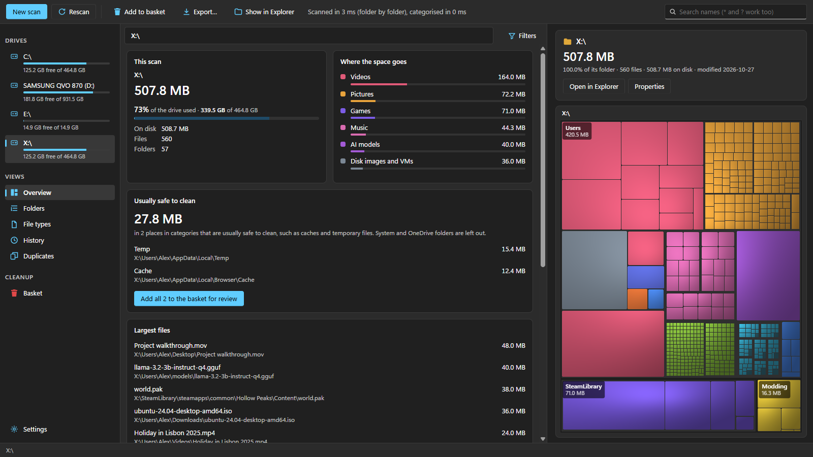
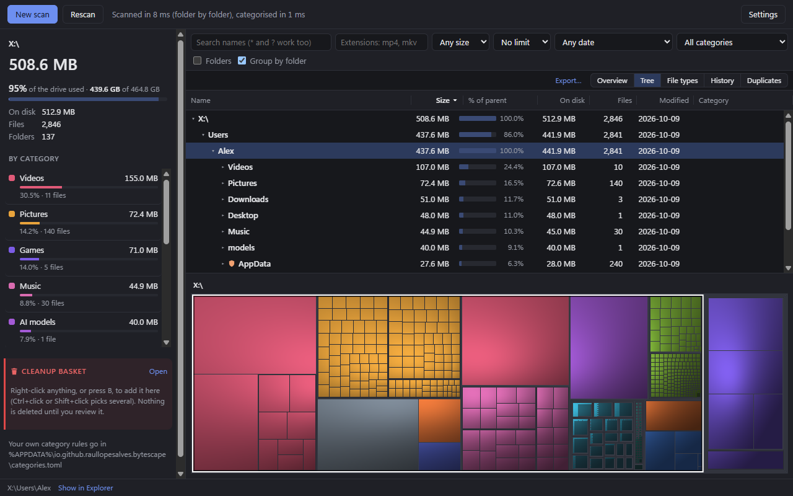

# Bytescape

A disk usage analyzer for Windows. It shows what takes up space on a drive or
folder, groups everything into categories (games, videos, caches, developer
dependencies, ...), and helps you clean up safely.



## Download

Get `Bytescape_<version>_x64-setup.exe` from the
[latest release](https://github.com/raullopesalves/bytescape/releases/latest)
and run it. It installs for your user only, without administrator rights, and
downloads WebView2 if Windows doesn't have it. The files aren't code-signed
yet, so SmartScreen may say "Windows protected your PC": choose **More info**,
then **Run anyway**.

Each release also has a standalone `Bytescape_<version>_x64_portable.exe`
(no install), the command-line tool, and SHA-256 checksums.

## What it does

- **Fast scans.** Folders are listed in parallel, about 2 seconds for
  C:\Windows and 20 seconds for a 4-million-file C:\ drive. Run as
  administrator, it reads the drive's NTFS file table (MFT) directly instead:
  about 6 seconds for that same drive.
- **Categories.** Every file gets a category from rules you can extend (see
  [Categories](#categories)). Folders deep inside others win, so
  `C:\Windows\Temp` counts as caches, not as Windows.
- **Tree and treemap.** A sortable folder tree next to a treemap coloured by
  category. Click either one to find the item in the other; double-click to
  zoom into a folder.
- **Search and filters** by name (with `*` and `?`), extension, size, age and
  category, grouped by folder (with the number of matches in each) or as one
  list by size. The treemap dims everything that doesn't match.
- **Flags** on anything that probably shouldn't be deleted by hand: Windows,
  program and boot folders, registry files, AppData, OneDrive.
- **Overview** after each scan: where the space goes, how much is in
  categories that are usually safe to clean, and the largest files.
- **History.** Each scan is remembered, so you can see which folders grew or
  shrank since an earlier scan.
- **Duplicates.** Finds files with identical contents while reading as little
  as possible (sizes, then the first and last 16 KB, then whole files).
- **Cleanup basket.** Collect what you want to remove (select several rows
  with Ctrl+click, Shift+click, Shift+arrows or Ctrl+A, then press B or
  Delete, or right-click), review it with a warning for anything risky, then move it to the Recycle Bin (or delete it
  for good, if you ask twice).
- **File types:** totals per extension, coloured by category; click one to
  see those files.
- **Windows cleanup:** empty the Recycle Bin, turn off hibernation, clean up
  Windows components and remove a previous Windows installation, all done
  by Windows itself.
- **All drives at once**, network shares (`\\server\share`), and "Scan with
  Bytescape" in Explorer's right-click menu (added by the installer).
- **Updates:** Bytescape checks for a new release when it starts and offers
  to install it (signed, so a tampered download is refused).
- **Export** a folder's contents or search results as CSV or JSON.



## Safety

Nothing is deleted without going through the cleanup basket and a
confirmation that lists every item and how much space it frees.

- The Recycle Bin is the default. If something can't go to the Recycle Bin
  (too big, or no Recycle Bin on that drive), Windows asks before deleting it
  for good. Deleting permanently needs a separate tick.
- Never deleted: links and junctions (what they point to stays safe),
  online-only OneDrive files (deleting them would delete the cloud copy),
  items in the Recycle Bin, and the scanned folder itself.
- Need their own confirmation: anything in Windows, Program Files or
  ProgramData, and anything synced with OneDrive.
- Each item is checked again just before deleting: if it changed since the
  scan (for example it became a link), it is left alone.
- Links are never followed while scanning, and online-only files are never
  opened, so nothing is downloaded.

## The MFT scan and administrator rights

Reading the NTFS Master File Table directly is several times faster than
listing folders, but Windows only allows it with administrator rights. Bytescape
never needs them: without them it lists folders as usual. When you scan a whole
drive without them, it offers "Scan faster as administrator", which restarts
it through the usual Windows prompt. The status line always says which method
was used.

## Categories

The built-in rules are in [crates/categories/rules/default.toml](crates/categories/rules/default.toml).
To add your own, create `%APPDATA%\io.github.raullopesalves.bytescape\categories.toml` in the
same format: a category with an existing id adds to it, a new id adds a
category. For example:

```toml
[[category]]
id = "games"
paths = ['D:\MyGames\**']

[[category]]
id = "work"
name = "Work"
color = "red"
cleanup = "never"
paths = ["?:/Users/*/Documents/Work/**"]
```

## Coming from diskmap

Bytescape was called diskmap during development. On its first start it moves
diskmap's data folders (`dev.diskmap.desktop` in `%APPDATA%` and
`%LOCALAPPDATA%`) to its own, so scan history, category rules and settings
carry over. Close any diskmap windows first; if a folder is still in use, it
stays where it is and Bytescape starts fresh.

## Building

You need Windows 10 or 11, [Rust](https://rustup.rs) (stable, MSVC), and the
Visual Studio Build Tools with the "Desktop development with C++" workload.
WebView2 is part of Windows 11 and recent Windows 10.

```
cargo test
cargo run --release -p bytescape-app            # the app
cargo run --release -p bytescape-cli -- C:\Windows   # the command-line tool
```

To build the installer, install the Tauri CLI once
(`cargo install tauri-cli --version "^2" --locked`), then:

```
cd crates/app
cargo tauri build
```

The installer is written to `target/release/bundle/nsis/`. It installs for the
current user, without administrator rights, and downloads WebView2 if it is
missing. It is not code-signed yet, so Windows SmartScreen warns about it.

### Making a release

Set the new version in `Cargo.toml` (`workspace.package`) and
`crates/app/tauri.conf.json`, run `cargo check` to update `Cargo.lock`, commit,
then push a tag:

```
git tag v0.1.0
git push origin v0.1.0
```

The release needs the update signing key in the repository secret
`TAURI_SIGNING_PRIVATE_KEY` (see CLAUDE.md). The Release workflow
(`.github/workflows/release.yml`) checks the tag matches
both versions, runs the tests, builds the installer, the standalone app and
the CLI on a clean Windows runner, and attaches them with checksums to a
**draft** release. Review the draft on GitHub, then publish it.

## Project layout

| Folder | What it is |
| --- | --- |
| `crates/scanner` | Scanner library: parallel folder walk or MFT read, a flat node tree, folder totals, hardlinks, size on disk |
| `crates/categories` | Category rules (TOML) and matching |
| `crates/history` | Scan snapshots in SQLite and "what grew" comparisons |
| `crates/dupes` | Duplicate file finder |
| `crates/cli` | `bytescape-cli`: scan from the command line, with JSON export |
| `crates/app` | The Tauri desktop app; its front end is plain HTML, CSS and JavaScript in `crates/app/ui` |

`docs/HANDOFF.md` has the design notes and measurements behind each part.

## License

Licensed under either of [Apache License, Version 2.0](LICENSE-APACHE) or
[MIT license](LICENSE-MIT), at your option. Third-party crates and their
licenses are listed in [docs/THIRD_PARTY_LICENSES.md](docs/THIRD_PARTY_LICENSES.md).

Unless you explicitly state otherwise, any contribution you submit for
inclusion in this project shall be dual licensed as above, without any
additional terms or conditions.
